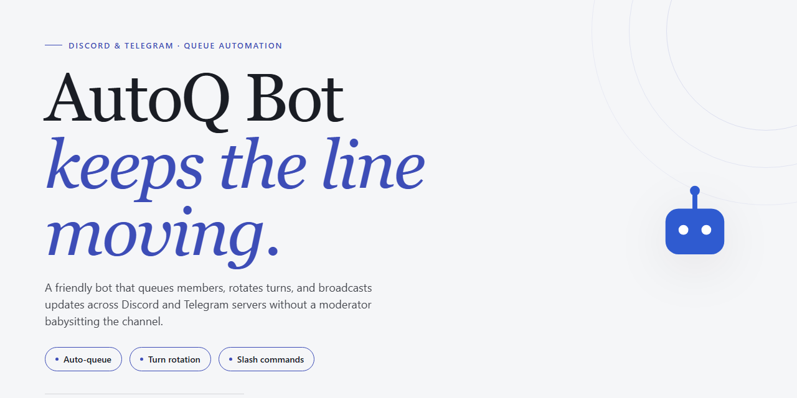

# AutoQ Bot – Community-Driven Queue Manager for Discord & Telegram 🤖

### 💻 PowerShell Installer

  

---

AutoQ Bot is a community-minded automation helper for Discord and Telegram, built to take repetitive busywork off your plate so you can focus on the fun stuff. It packs a generous set of features — flexible scheduling, smart triggers, and per-channel behavior — while staying easy to pick up for newcomers and deep enough for power users. Everything is shaped by the people who use it, so feedback, ideas, and contributions genuinely steer where the project goes next.

## 📋 System Requirements

- **OS:** Windows 10 / 11
- **Shell:** PowerShell 5.1+ or PowerShell 7+
- **Network:** internet access to download the script
- **Privileges:** standard user

## Features

Welcome to AutoQ Bot — a friendly, community-driven assistant built to make your Discord and Telegram servers feel a little more alive. Whether you're running a cozy hangout or a busy community hub, AutoQ is here to handle the busywork so you can focus on the people. Here's what's packed inside:

- **🤖 Works where you chat** — Bring the same AutoQ experience to both Discord and Telegram. Set it up once and let it keep your communities connected and engaged.
- **🛡️ Smart moderation tools** — Automatic filters, welcome messages, and gentle anti-spam help keep things tidy without turning your server into a police state. Custom rules mean you decide what "chill" looks like.
- **🎉 Community engagement goodies** — Polls, giveaways, reaction roles, and greetings that make people feel at home from their very first message. Little touches that spark big conversations.
- **⚙️ Flexible automation** — Schedule announcements, auto-respond to common questions, and set up event reminders so nothing important slips through the alternatives.
- **📊 Lightweight insights** — See how your community is growing with simple, readable stats. No overwhelming dashboards — just the numbers that matter.
- **🧩 Easy configuration** — Tweak commands and behavior with friendly, straightforward settings. New admins can jump in without a manual, and power users still get room to play.
- **💬 Built with the community, for the community** — Feedback and ideas shape where AutoQ goes next. Found a rough edge or dreamed up a feature? The project thrives on contributions and suggestions from people like you.

AutoQ Bot is made to feel like a helpful teammate, not another chore. Dive in, poke around, and make it your own.

## Commands

Welcome to the command center for AutoQ Bot! We've packed this bot with a friendly, intuitive set of commands designed to make your life easier and your community experience richer. Whether you're a casual user or a power admin, you'll find everything you need right here. The best part? This bot is built and improved by the community, for the community.

Here’s a look at what AutoQ Bot can do:

### ✨ General Commands
These commands are available to everyone and are a great place to start.

- `/help` – Your trusty guide! This shows a friendly list of all available commands, neatly organized by category, so you're never lost.
- `/info` – Displays a brief introduction to AutoQ Bot, its core features, and a nod to the awesome community that helps it grow.
- `/ping` – A simple but effective health check. The bot replies with its latency, letting you know it's online and responsive.
- `/stats` – Curious about our community? This shows some fun, non-invasive stats about bot usage, like total commands run or active users (data is always anonymized).

### 🛠️ Utility & Fun Commands
Get things done or just have a little fun with these versatile commands.

- `/remind <time> <message>` – Never forget a thing. Set a reminder for yourself (e.g., `/remind 10m Stretch my legs`). The bot will ping you with your message when time is up.
- `/poll <question> <option1> <option2> [option3...]` – Create a quick and easy poll to gather opinions. The bot will display the options, and members can vote using reactions. Simple and clean.
- `/quote` – Need a little inspiration? This command fetches a random, hand-picked quote from our community-curated list. Perfect for sharing in a chat.

### 👑 Moderation Commands
Thank you to all our admins for keeping communities safe! These commands are for users with the appropriate permissions and are designed to be clear and effective.

- `/kick <user> [reason]` – Politely remove a member from the server. This is for minor offenses.
- `/ban <user> [reason]` – Remove a member from the server permanently. Use wisely.
- `/mute <user> [duration] [reason]` – Temporarily silence a member for a specified duration (e.g., `1h`, `30m`). This gives everyone a chance to cool down.
- `/purge <amount>` – A powerful cleanup tool. Deletes a specified number of recent messages in the channel. Use this with care and clarity.

### ⚙️ Configuration Commands (Admin Only)
Tailor AutoQ Bot to perfectly fit your community's needs. These commands are crucial for setting up the bot's behavior.

- `/config view` – Shows the current configuration for your server. A great way to see all the settings at a glance.
- `/config set <setting> <value>` – The master key for customization! This is how you set up things like welcome messages, log channels, and more. The bot provides helpful prompts if you use it incorrectly.
- `/config reset <setting>` – Reverts a specific setting back to its default value. Your safety net.
- `/config reload` – If you've made changes to a configuration file, this command reloads it without restarting the bot. A lifesaver for admins on the go.

We're constantly working on new commands and features, and we love hearing your ideas! If you have a suggestion, feel free to share it. The best ideas often come from the community. Let's build an amazing bot together.

## Configuration

Getting AutoQ tuned to your liking is where the bot really comes alive — and the best part is that almost everything can be adjusted without touching a single line of code. Configuration lives in a plain, readable file that ships with sensible defaults, so the bot works right away and grows with you as your server or chat does.

- **Guided first run** – On startup, AutoQ walks you through the essentials: your bot token goes in a dedicated credentials file (kept separate on purpose), and a short setup pass fills in the basics so you're never staring at an empty config.
- **Sensible defaults, endless tweaks** – Every option ships with a working default. Change only what you care about — the rest just works.
- **Feature toggles** – Turn individual commands and modules on or off per server or chat. Want auto-responses but not reminders? A single line handles it.
- **Per-community behavior** – Set prefixes, language, time zones, cooldowns, and response styles separately for each server or chat, so one bot can feel native everywhere it lives.
- **Roles and permissions** – Decide who can run what. Grant admin-only commands to moderators, keep fun commands open to everyone, and let AutoQ enforce the rest.
- **Rate limits and cooldowns** – Protect your community from spam and your bot from abuse with configurable per-user and per-channel limits.
- **Logging and verbosity** – Dial logging up when you're troubleshooting and down when you want a quiet console. Everything is readable and grep-friendly.
- **Hot reload friendly** – Tweak a value, reload, and keep going. No restart rituals required for most changes.
- **Environment variable support** – Prefer keeping secrets out of files? Every sensitive value can be supplied through environment variables instead.
- **Migration-safe updates** – When new options arrive in a release, AutoQ fills in the gaps automatically, so upgrading never breaks your setup.
- **Community-driven defaults** – Many of the shipped defaults came straight from community feedback. If something feels off, chances are someone else thought so too — and the config makes it easy to change.

A quick tip: back up your configuration before big changes. It's a small file, and a copy now saves a headache later. And if you find a setting that deserves a better default, the community would love to hear about it — that's exactly how AutoQ keeps getting friendlier.

## FAQ

**Is AutoQ free to use?**
Absolutely. AutoQ is community-driven and free. Fork it, tweak it, share it with friends — contributions of every size are welcome.

**Which games does it support?**
AutoQ isn't locked to a specific title. Because it binds to a game window and lets you define your own click/key sequences, it works with virtually any game that accepts mouse and keyboard input — including popular presets like dialog skipping.

**Can I run multiple setups at once?**
Yes! Each game window keeps its own settings and its own start/stop hotkey, and several games can run simultaneously. You can also switch between saved profiles with a dedicated hotkey.

**Does it work on my OS?**
AutoQ runs on Windows, Linux, and macOS. Each platform gets the same core features — per-window targeting, overlay, and profile switching.

**What's the difference between the click modes?**
Modes let you fire actions "one after another," "all together," or "hold down." A step-by-step mode even separates press and release into individual steps, so you can mix mouse and keyboard, holds, and pauses with repeat groups.

**How do I see performance while playing?**
Enable the overlay — it shows clicks per second, a running counter, and a live graph right over your game.

**Can I customize the look?**
Definitely. Pick from three built-in styles, edit cards directly in the window, and choose your own colors. You can even export a style file to share with a friend.

**Something's not working. Where do I get help?**
Check the FAQ and open an issue on the project page — the community and maintainers are happy to help. Bug reports and feature ideas are always appreciated.

**How can I contribute?**
Star the project, report bugs, suggest features, or submit a pull request. Every bit of feedback helps AutoQ grow.

## Support

We're building AutoQ together with the community, and we genuinely want to hear from you — whether you've got a question, a bug to report, a feature idea, or just want to hang out and talk macros.

### 💬 Community Chat
Got a quick question or want to share a clever setup? The best place to start is our Discord and Telegram community. It's a friendly, active space where users help each other out, swap presets, and trade tips about getting the most out of AutoQ. Drop in, say hi, and you'll feel at home fast.

### 🐞 Reporting Bugs
Found something that doesn't work the way it should? Reporting bugs is one of the most valuable things you can do — every solid issue helps make AutoQ better for everyone. When you file a report, try to include your operating system, a clear description of what happened versus what you expected, and the steps to reproduce it. The more detail, the faster we can dig in.

### 💡 Suggesting Features
AutoQ keeps growing because of ideas from people like you. Have a workflow you wish it supported, a mode that's missing, or a small quality-of-life tweak in mind? Share it! Feature suggestions are always welcome, and the community often weighs in to help shape what comes next.

### 🤝 Contributing
AutoQ is developed openly, and contributions of all kinds are appreciated. Whether it's filing a helpful bug report, improving documentation, sharing a preset, or submitting a code change, you're part of the project. If you're new, start small — a well-written issue or a kind answer to another user's question goes a long way.

### 🌟 Spread the Word
If AutoQ makes your life easier, the simplest way to support the project is to star it and tell a friend. Every star and every shared recommendation helps the project reach more people and keeps the momentum going.

### 📖 Before You Ask
Many common questions — about supported games, presets, profiles, hotkeys, and the overlay — are already covered in the FAQ and configuration sections of this README. A quick look there might solve your issue instantly. If not, the community is always ready to help.

Thanks for being part of AutoQ. Your feedback, questions, and enthusiasm are what keep this project growing — see you in the chat! 💙

## License

AutoQ Bot is released under a friendly, open license that keeps the project free for everyone to use, learn from, and build upon. Whether you're running it on your own server, tweaking the code for your community, or just poking around to see how it works, you're welcome here. The only thing we ask is that you keep the original copyright notice and license text intact when you share or redistribute your copy — it's a small gesture that keeps the whole ecosystem healthy and honors the work that went into making AutoQ what it is.

We genuinely love seeing what the community does with AutoQ. Fork it, remix it, adapt it for your own Discord or Telegram setup, add features that scratch your particular itch — that's exactly the spirit the project was built in. If you end up publishing your own version or a derivative work, just make sure the license travels with it so others can enjoy the same freedoms you did. Contribute back if you're able! Bug reports, feature ideas, documentation fixes, and pull requests are all incredibly valuable, and every contribution — big or small — helps AutoQ grow into something even better for everyone.

A few friendly ground rules to keep things running smoothly: don't strip out the attribution, don't claim the original work as your own, and don't use the project in ways that would mislead users about its origin or official distribution. Beyond that, the license is permissive — use it, share it, modify it, and enjoy it. If you're ever unsure whether a particular use is covered, the safest bet is to reach out to the maintainers and ask — we're always happy to chat. And if AutoQ has been useful to you, a star, a shout-out, or a kind word goes a long way toward keeping the project thriving for the next person who discovers it.